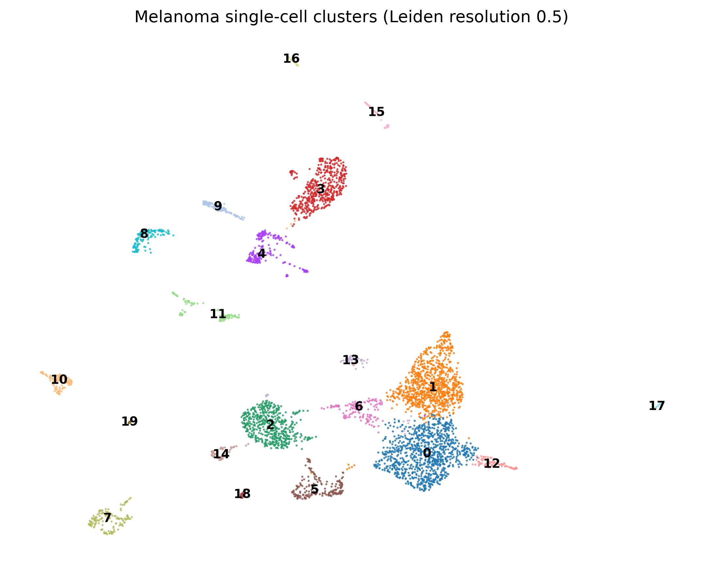
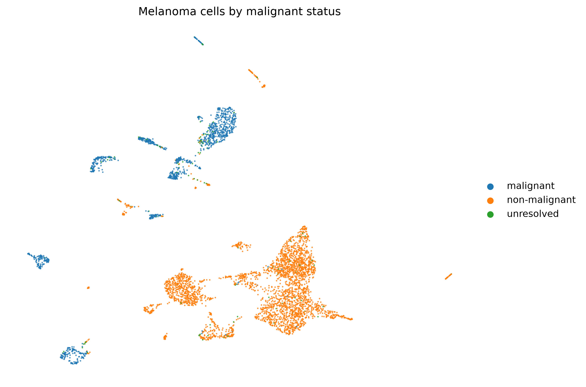
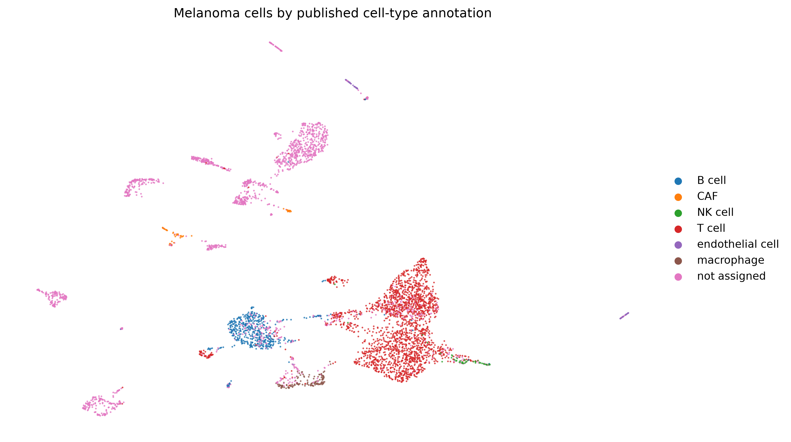
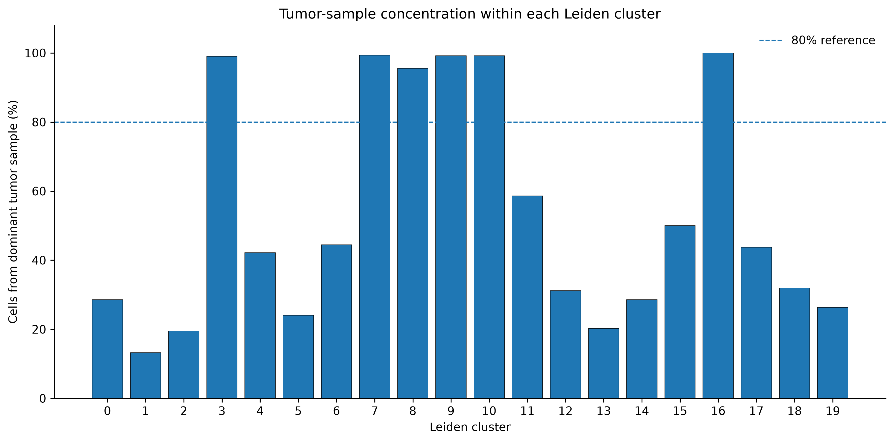

# Single-Cell Dissection of Metastatic Melanoma

## Project overview

This project analyses a published single-cell RNA-sequencing (scRNA-seq)
expression dataset from metastatic melanoma using Python and Scanpy.

The objectives are to examine transcriptional heterogeneity, compare
dimensionality-reduction feature sets, identify cell clusters, investigate
cluster marker genes, and assess how clusters relate to published cell
annotations, malignant status, and tumor sample identity.

**Project status:** Core Scanpy analysis completed; final documentation
and repository preparation in progress.

## Dataset

- **Accession:** GSE72056
- **Study:** Tirosh et al. (2016), Dissecting the multicellular ecosystem
  of metastatic melanoma by single-cell RNA-seq.
- **Source:** NCBI Gene Expression Omnibus (GEO)
- **Input:** Published processed expression matrix and associated metadata
- **Analysed cells:** 4,645
- **Gene rows in the imported matrix:** 23,686

The project uses a processed expression matrix. It does not start from raw
FASTQ reads and does not perform read alignment, reference-genome indexing,
or raw-read quantification.

Dataset landing page:
https://www.ncbi.nlm.nih.gov/geo/query/acc.cgi?acc=GSE72056

## Objectives

1. Import and validate the expression matrix and cell metadata.
2. Inspect expression characteristics and quality-control metrics.
3. Compare gene-selection strategies for downstream analysis.
4. Perform PCA and UMAP using alternative feature sets.
5. Cluster cells using the Leiden algorithm.
6. Identify cluster marker genes and develop cautious working annotations.
7. Compare cluster composition with published cell labels, malignant status,
   and tumor sample identity.
8. Produce reproducible figures, tables, and scripts.

## Workflow

1. **Data import and validation**
   - Read the published expression matrix.
   - Inspect matrix dimensions, gene identifiers, and cell annotations.
   - Validate cell identifiers and expression values.

2. **Expression and quality assessment**
   - Examine expression distributions and detected genes.
   - Compare quality metrics across malignant-status and published
     cell-type groups.
   - Inspect gene variability and the expression scale.

3. **Feature selection**
   - Select 2,000 highly variable genes using Scanpy.
   - Compare this feature set with genes detected in at least 5% of cells.

4. **Dimensionality reduction**
   - Run PCA and compare variance explained by the two feature sets.
   - Compute neighborhood graphs and UMAP embeddings.
   - Audit embedding coordinates and graph properties.

5. **Clustering**
   - Apply Leiden clustering at resolution 0.5 to the 2,000-HVG analysis.
   - Obtain 20 clusters in this analysis.
   - Compare cluster sizes and distributions of published annotations,
     malignant status, and tumor samples.

6. **Marker analysis and annotation**
   - Identify cluster-associated marker genes using the Wilcoxon test.
   - Apply Benjamini-Hochberg adjustment to marker-test p-values.
   - Review canonical marker panels and published annotations.
   - Assign provisional cluster labels with confidence and supporting
     evidence, retaining unresolved labels where evidence is insufficient.

7. **Sample-composition audit**
   - Quantify the number of tumor samples represented in each cluster.
   - Calculate the fraction of each cluster contributed by its dominant
     tumor sample.
   - Plot sample concentration to highlight potential sample-specific
     structure.

## Selected results

- The imported dataset contains 4,645 cells and 23,686 gene rows.
- The analysis compared a 2,000-HVG feature set with a set of 564 genes
  detected in at least 5% of cells.
- The first 30 PCs explained 22.43% of variance for the 2,000-HVG set
  and 30.55% for the 564-gene set.
- Leiden clustering at resolution 0.5 produced 20 clusters for the
  2,000-HVG analysis and 17 clusters for the alternative feature set.
- Marker analysis and canonical marker review supported several broad
  cell-population labels, including T-cell-enriched, B-cell, myeloid,
  NK-cell, endothelial, and plasma-cell/B-lineage-enriched populations.
- Several clusters were enriched for cells labelled malignant in the
  supplied metadata.
- A sample-composition audit identified clusters 3, 7, 8, 9, 10, and 16
  in which a single tumor sample contributed approximately 95% or more
  of the cells.

The PCA variance figures are descriptive and do not by themselves establish
that one feature set is biologically superior.

## Selected figures

### Leiden clustering



The Leiden analysis at resolution 0.5 identified 20 clusters in the 2,000-HVG feature set. Cluster assignments are exploratory.

### UMAP coloured by supplied malignant-status labels



These labels are supplied dataset annotations and are not independent validation of malignancy.

### UMAP coloured by published cell-type annotations



The plot shows the published annotations across the embedding; it should not be interpreted as definitive validation of every cluster identity.

### Tumor-sample composition by cluster



This audit highlights clusters with high contributions from individual tumor samples, which may reflect biological heterogeneity, sampling, technical effects, or a combination of factors.

## Important limitations

- The input is a published processed expression matrix; raw-read alignment
  and reference-genome processing were not performed.
- Published cell annotations and malignant-status labels are treated as
  supplied metadata, not as independent ground truth.
- Cluster labels are working annotations based on marker evidence and
  metadata, not definitive cell identities.
- Several malignant-enriched clusters are strongly concentrated in one
  tumor sample. These clusters may reflect tumor-specific biology,
  technical or sampling effects, or a combination of factors.
- Tumor sample identifiers should not automatically be assumed to represent
  independent patients.
- UMAP is a visualization of a low-dimensional embedding. Distances in
  the plot should not be interpreted as direct measures of biological
  distance.
- Pathway analysis, comprehensive immune-state analysis, and validated
  malignant-state programs are not claimed as completed in this version.

## Repository structure

```text
single_cell_project/
├── data/
│   ├── raw/                 # Local source data; excluded from Git
│   ├── metadata/            # Dataset metadata
│   └── processed/           # Local processed AnnData objects; excluded
├── scripts/                 # Numbered analysis and plotting scripts
├── results/
│   ├── annotation/
│   ├── clustering/
│   ├── markers/
│   ├── pca/
│   ├── qc/
│   └── umap/
├── figures/
│   ├── clustering/
│   ├── pca/
│   ├── qc/
│   └── umap/
├── docs/
├── notebooks/
├── .gitignore
├── requirements.txt
└── README.md
```

## Software

The analysis was developed with:
- Python 3.11.17
- Scanpy 1.11.5
- AnnData 0.12.19
- NumPy 2.4.6
- pandas 2.3.3
- Matplotlib 3.11.2
- SciPy 1.17.1
- scikit-learn 1.9.1
The versions are recorded in requirements.txt. Reproduction may require
additional dependencies used by individual scripts; the environment should
be tested in a clean installation before claiming full reproducibility.

### Environment setup

Create a Python 3.11 environment and install the pinned dependencies:

```bash
conda create -n melanoma-scrna-repro python=3.11 -y
conda activate melanoma-scrna-repro
python -m pip install -r requirements.txt
```

### Required input files

Download the processed expression matrix and GEO family metadata from the [GSE72056 GEO record](https://www.ncbi.nlm.nih.gov/geo/query/acc.cgi?acc=GSE72056). Confirm the correct files on the GEO page; this repository does not redistribute the source dataset.

Place the processed expression matrix at `data/raw/GSE72056_melanoma_single_cell_revised_v2.txt.gz` and the uncompressed GEO family metadata at `data/metadata/GSE72056_family.soft`.

The metadata parser expects an uncompressed `.soft` file. If you download `GSE72056_family.soft.gz`, decompress it before running the metadata scripts. Create required directories with `mkdir -p data/raw data/metadata data/processed`.

## Reproducibility

The imported matrix contains 23,686 gene rows and 23,684 unique
original gene symbols; two original gene symbols occur on repeated
rows. The imported AnnData object uses unique gene identifiers.

Analysis scripts are numbered to reflect the workflow stages. They should
be run from the project root in the documented order, using the expected
input and output paths. Large data objects are excluded from Git to keep
the repository manageable.

Before reproducing the workflow, obtain the source data from GEO and place
it in the expected local path. Consult the scripts for exact input filenames
and command details. Do not assume that every script can be rerun
independently without outputs from earlier stages.

### Script sequence

Run scripts from the project root, in numbered order, after obtaining the required source files. Later scripts depend on intermediate outputs from earlier stages.

| Scripts | Purpose |
|---|---|
| `01–06` | Import, validate, and inspect expression and QC |
| `07–09` | Parse GEO metadata, validate metadata mapping, and audit expression scale |
| `10–13` | Explore variability and select/compare gene features |
| `14–20` | Prepare feature sets, compare PCA and UMAP, and perform Leiden clustering |
| `21–25` | Identify marker genes, validate and review cluster annotations, and combine annotation tables |
| `26–30` | Generate figures and audit tumor-sample composition |

The script numbers describe the intended analysis stages, not a guarantee that all scripts can be run independently. Consult each script for its exact inputs and outputs.

## Citation
Tirosh I, Izar B, Prakadan SM, et al. Dissecting the multicellular ecosystem
of metastatic melanoma by single-cell RNA-seq. Science. 2016;352(6282):
189–196. doi:10.1126/science.aad0501.

Please cite the original study and GSE72056 when reusing the dataset.
## License
A repository license has not yet been selected. Before public release,
choose a license appropriate for the original data, code, and intended reuse.
